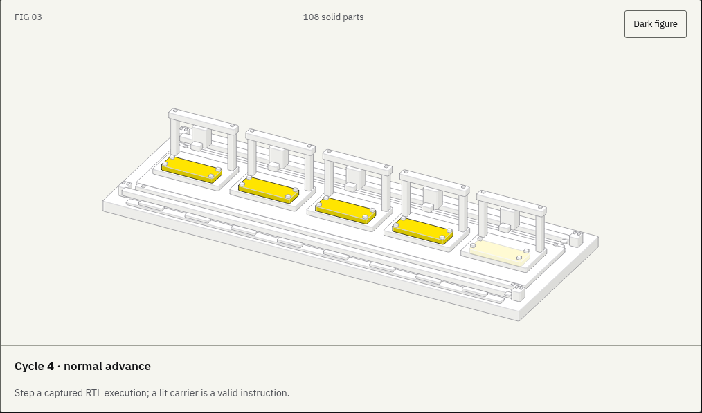
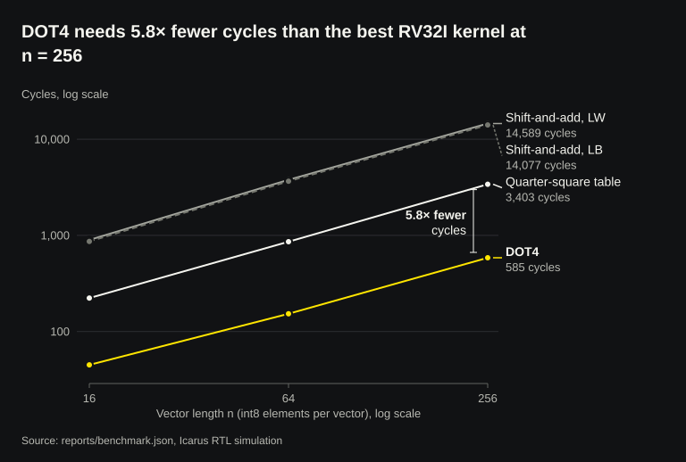
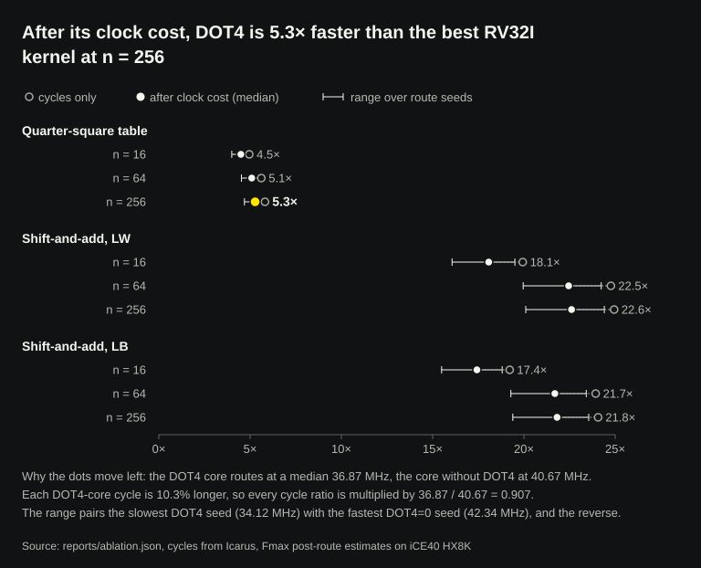

# Five-stage RV32I core with DOT4: an educational SystemVerilog CPU checked against Spike in simulation

[](https://github.com/RahilBhavan/riscv/actions/workflows/verify.yml) [](LICENSE)



This is a five-stage (IF/ID/EX/MEM/WB) RV32I core in SystemVerilog with forwarding, a load-use interlock, EX-stage branch flushing and a custom signed int8 dot-product instruction, DOT4. The repository checks the core in Icarus and Verilator against a Python reference model and against Spike, and maps it to a Lattice iCE40 HX8K with Yosys and nextpnr. All results come from simulation and place-and-route. The FPGA figures are estimates, **35.76 MHz median over five route seeds** (33.85–37.08 MHz), and no board has run the core.

## Results

Measured on the checked-in RTL with Icarus 12.0, Verilator 5.020, Spike (riscv-isa-sim `5a760667`), Yosys 0.33 and nextpnr-ice40 0.6. Each report records the SHA-256 of the sources it measured. `scripts/textbook/check-readme.mjs` stops the build if this README quotes a number that differs from `reports/`.

Verification:

- **Correctness.** 252 directed, random and generated hazard programs pass in both simulators. 11,924 retired instruction records and all byte writes match the reference model, over 20 deterministic random seeds. Invariants in `tests/invariants.svh` check x0, register writes, memory strobes, stall and flush on all 14,906 cycles. A DOT4=0 run checks that custom-0 traps. Source: [`reports/verification.json`](reports/verification.json).
- **External reference.** 39/39 RV32I tests from riscv-arch-test 3.10.0 (the last RISCOF-format release) match Spike's signatures, and 50 random programs match its commit log. This is not ACT4 and not certification. Source: [`reports/isa-compare.json`](reports/isa-compare.json).
- **Hazard cross.** 108 generated programs hit 327/327 bins: 7 producer classes × 14 consumer operand slots × distance 1–3, plus x0 and wrong-path bins. Source: [`reports/verification.json`](reports/verification.json).
- **DOT4 sweep.** Both simulators run all 262,144 isolated signed lane pairs through the core, and every result matches a scalar oracle. All 1,024 custom-0 encodings run from reset, and the 1,023 unsupported ones trap with no side effect. Multi-lane sums are not swept exhaustively. Source: [`reports/dot4-sweep.json`](reports/dot4-sweep.json).
- **Mutants.** The targeted checkers catch 23/23 single-bug edits to the RTL. Source: [`reports/mutation.json`](reports/mutation.json).
- **Line coverage.** 37/38 core line instrumentation points = 97.37%, with no exclusions. The source has only 38 instrumented points, so this metric is weak evidence on its own. Source: [`reports/line-coverage.json`](reports/line-coverage.json).
- **Functional plan.** 46/46 instruction/branch-outcome/trap bins hit. Source: [`reports/verification.json`](reports/verification.json).

Performance and FPGA estimates:

- **DOT4 speedup.** In the benchmark, for a 256-element int8 dot product, DOT4 takes 585 cycles. A quarter-square table kernel, the strongest pure-RV32I version, takes 3,403 cycles, and shift-and-add takes 14,589. Dividing each count by its own core's median post-route Fmax gives 5.3× over quarter-square (4.7–5.7× when pairing extreme seeds) and 22.6× over shift-and-add. So DOT4 is 5.3× faster on this kernel after its clock cost. Sources: [`reports/benchmark.json`](reports/benchmark.json), [`reports/ablation.json`](reports/ablation.json).
- **DOT4 cost.** Compared with a DOT4=0 build, the unit adds 18% logic cells and costs 9% of median Fmax. Source: [`reports/ablation.json`](reports/ablation.json).
- **Mapped area.** 3,935 LUT4 primitives and 1,692 flip-flops, packed into 5,497/7,680 iCE40 logic cells (71.6%). These are FPGA resources, not ASIC area. Source: [`reports/implementation.json`](reports/implementation.json).
- **Timing estimate.** 35.76 MHz median internal post-route estimate over nextpnr seeds 1–5, range 33.85–37.08 MHz. The official seed-1 report is 33.85 MHz. The 12 MHz constraint passes on every seed. The shell excludes the memories, peripherals and external I/O timing. Round it to ~36 MHz post-route on iCE40 HX8K. Do not write "runs at" until a board runs a checked program at that clock. Sources: [`reports/implementation.json`](reports/implementation.json), [`reports/raw/nextpnr.log`](reports/raw/nextpnr.log).
- **Board image.** `make board` builds a bitstream for the iCE40-HX8K Breakout with block-RAM memories and a self-test that reports on the LEDs and UART. The self-test passes in RTL simulation, and the image routes at 36.92 MHz post-route against the board's 12 MHz oscillator. It has not run on a board. Sources: [`docs/BOARD.md`](docs/BOARD.md), [`reports/board.json`](reports/board.json).

 

## Interactive figures

Each page is self-contained and reads its numbers from `reports/` and its cycle-by-cycle behaviour from the RTL traces in `reports/visual-traces.json`. They are hosted on [GitHub Pages](https://rahilbhavan.github.io/riscv/output/START-HERE.html) and also work offline from a clone. `make figures` rebuilds them.

- [Pipeline machine](https://rahilbhavan.github.io/riscv/output/figures/pipeline-machine/): the five stages as an isometric machine. Step six recorded traces and watch stalls, flushes and forwarding.
- [Why a load stalls](https://rahilbhavan.github.io/riscv/output/figures/load-use-explainer/): a stepped explainer of the load-use interlock, with a "try it" model checked against the traces.
- [DOT4 machine](https://rahilbhavan.github.io/riscv/output/figures/dot4-machine/): edit the eight lane bytes and follow them through the multipliers and adder tree. It also plays the board self-test, which has only run in simulation.
- [Evidence charts](https://rahilbhavan.github.io/riscv/output/figures/evidence/): cycles, speedup after clock cost, Fmax per seed, area and hazard coverage. Static SVG copies are in `output/figures/evidence/svg/`.
- [Write-up](https://rahilbhavan.github.io/riscv/output/figures/post/) and a [20-second video](https://rahilbhavan.github.io/riscv/output/figures/video/riscv.mp4) (`make figure-video`).

## How it works

- `rtl/rv32_core.sv` is the core. EX takes operands from EX/MEM, then MEM/WB, then ID/EX. A load followed directly by a consumer stalls one cycle. Taken branches and jumps resolve in EX and squash the two younger stages. ECALL, EBREAK, illegal encodings and misaligned accesses halt through a local trap record.
- DOT4 uses custom-0 (`opcode=0x0b`, `funct3=0`, `funct7=0`): `rd = Σ signed8(rs1.byte[i]) × signed8(rs2.byte[i])` for `i = 0..3`, with no accumulation or saturation. The GNU assembler form is `.insn r 0x0b, 0, 0, a0, a1, a2`.
- `tests/run.py` generates the programs, runs them on `tests/tb.sv` and compares every retirement and byte write with its own sequential model. `tests/isa_compare.py`, `tests/dot4_sweep.py` and `tests/mutants.py` add Spike, the lane sweep and the mutants.
- `rtl/timing_top.sv` is the registered shell for synthesis and route. `rtl/board_top.sv` is the board image.
- `scripts/build.sh` (`make all`) runs the RTL steps in Docker, then builds the textbooks, visual lab, figures and release ZIP from `reports/`.

## Run it

You need Docker. The `Dockerfile` pins Ubuntu 24.04 and its Icarus, Verilator, Yosys and nextpnr-ice40 packages, builds Spike from a pinned commit and fetches riscv-arch-test 3.10.0 by checksum. No credentials are needed.

```sh
git clone https://github.com/RahilBhavan/riscv.git
cd riscv
docker build -t rv32-tools .
docker run --rm --user "$(id -u):$(id -g)" -v "$PWD:/work" rv32-tools make test lint reset-test
```

`make test` runs the regression in Icarus with DOT4=1 and again with DOT4=0. On 2026-10-21, 252 programs pass in each run, lint is clean and `make reset-test` passes. `make coverage` reruns the programs in Verilator. The tests rewrite files in `reports/` and `build/`.

The other evidence targets use the same image:

```sh
docker run --rm --user "$(id -u):$(id -g)" -v "$PWD:/work" rv32-tools \
	make coverage timing isa-compare dot4-sweep mutants bench ablation board-sim board
```

`make all` runs everything, then builds the textbooks, visual lab, interactive figures and `output/riscv-project.zip`. It also needs Node.js 22 or newer, Chromium and Poppler on the host. See [`docs/BUILD_ALL.md`](docs/BUILD_ALL.md), then open [`output/START-HERE.html`](output/START-HERE.html).

## Repository layout

- `rtl/`: the core, the timing shell and the board top.
- `tests/`: testbenches, invariants, program generators, the Spike comparison, the DOT4 sweep and the mutants.
- `scripts/`: report, benchmark and ablation scripts, and the textbook, visual-lab and release builders.
- `reports/`: checked-in JSON reports and raw route and synthesis logs.
- `board/`: pin constraints for the iCE40-HX8K Breakout.
- `docs/`: architecture, build guides, research workflow, experiment log, textbook sources and the visual-lab plan.
- `output/`: built textbooks, visual lab, interactive figures, start page and release ZIP.
- `assets/`: the project icon.

## Documentation

- [Architecture](docs/ARCHITECTURE.md): pipeline, hazards, memory contract, traps, DOT4 encoding and measurement boundary.
- [Build the whole project](docs/BUILD_ALL.md): requirements, build order and outputs of `make all`.
- [Extended build and research guide](docs/BUILD_GUIDE.md): a 15-day path to rebuild the datapath, design experiments and earn claims you can defend.
- [Research and experiment workflow](docs/RESEARCH.md): primary sources for each stage and how to keep proposed experiments apart from results.
- [Two-day build sprint](docs/TWO_DAY_BUILD.md): the original October 17–18 plan.
- [Board guide](docs/BOARD.md): build, flash and record a first hardware run.
- [Experiment log](docs/EXPERIMENT_LOG.md): dated results, including the Spike comparison, benchmark and ablation.
- [Illustrated textbook](docs/textbook/README.md) and [build series](docs/textbook/series/README.md): a 35-page overview and eight volumes of 114 pages.
- [Visual lab](docs/visual-lab/README.md): open and rebuild the eight-part interactive lab.
- [Documentation index](docs/README.md): every file in `docs/`.

## Sources

- **riscv-arch-test 3.10.0** from [riscv-non-isa/riscv-arch-test](https://github.com/riscv-non-isa/riscv-arch-test), fetched by tag and checked against a SHA-256 in the `Dockerfile`.
- **Spike** from [riscv-isa-sim](https://github.com/riscv-software-src/riscv-isa-sim) commit `5a760667bf0d0ab893173b9eeff9c109c8d7dd9a`, also checked against a SHA-256.
- **Tools** from Ubuntu 24.04 packages. The implementation, ablation, board, line-coverage and ISA-comparison reports record their versions.

The regression programs are generated in Python and use no external data.

## Scope and limits

- This is independent educational work. It is not affiliated with RISC-V International, Lattice or any lab named in the docs.
- The project started from a placeholder README with no earlier core draft. The implementation was generated with assistant support.
- All FPGA timing figures are post-route estimates. No board has run the core (`board_tested: false` in `reports/board.json`).
- The core assumes separate instruction and data memories with combinational reads. It has no CSRs, interrupts, privileged traps or memory wait states. FENCE is a no-op, and FENCE.I is absent.
- The project has no formal verification (riscv-formal with RVFI), no ACT4 integration and no certification.
- The DOT4 speedup covers one kernel. The table baseline also uses 2 KiB of data memory that DOT4 does not.
- `reports/raw/regression.log` is from an older 144-program run. The current figures are in `reports/verification.json`.

## License

MIT. See [LICENSE](LICENSE). It covers this project's code, not riscv-arch-test or Spike.

Part of [Rahil Bhavan's projects](https://github.com/RahilBhavan).
